<p align="center">
  
</p>

<h1 align="center">tully</h1>

<p align="center">
  A menu bar companion for your Mac: system stats, window tiling with a radial ring, a window switcher,
  Disk Clean, a drag-and-drop file converter, and small power tools.<br>
  No App Store. No subscription. No telemetry. Everything runs locally.
</p>

---

## Contents

- [Features at a glance](#features-at-a-glance)
- [Menu bar stats](#menu-bar-stats)
- [System monitor](#system-monitor)
- [Disk and Disk Clean](#disk-and-disk-clean)
- [Window manager: zones, Window Ring and tiling suggestions](#window-manager)
- [Window switcher](#window-switcher)
- [File Converter](#file-converter)
- [Stay Awake and Keyboard Cleaning](#stay-awake-and-keyboard-cleaning)
- [Settings](#settings)
- [Permissions](#permissions)
- [Requirements](#requirements)
- [Build and run](#build-and-run)
- [Testing](#testing)
- [Project layout](#project-layout)
- [Privacy, uninstall and credits](#privacy-uninstall-and-credits)

---

## Features at a glance

| System | Disk | Windows |
| :---: | :---: | :---: |
| 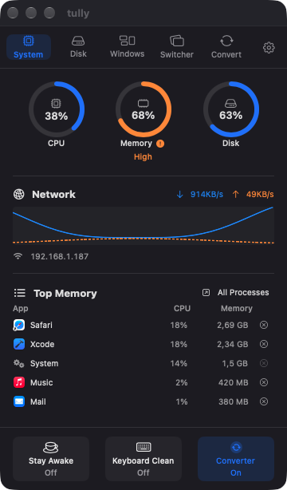 | 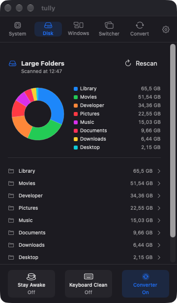 | 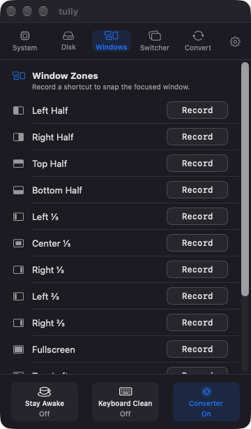 |

| Window Ring | Tiling suggestions | File Converter wheel |
| :---: | :---: | :---: |
| 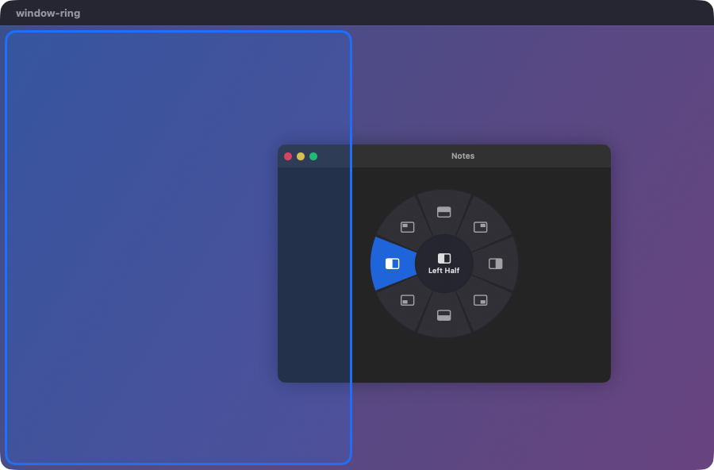 | 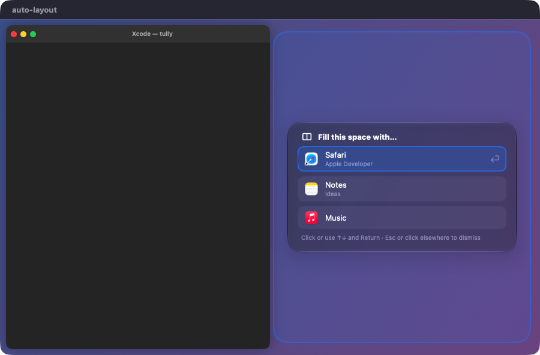 | 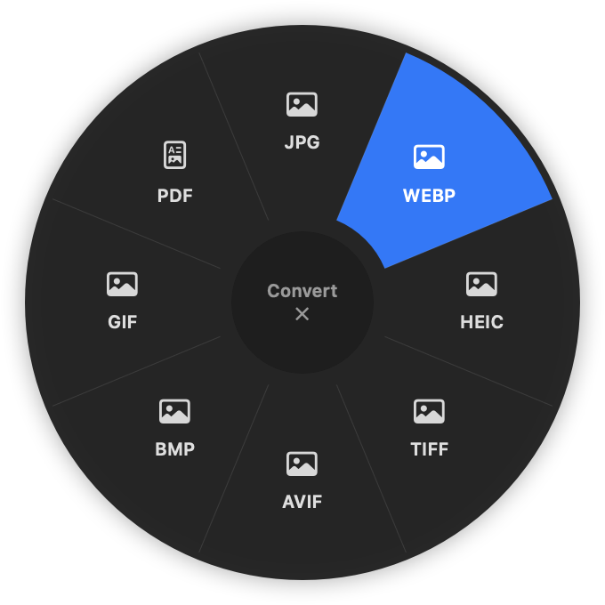 |

Click the menu bar icon for the popover:

- **Tabs:** System · Disk · Windows · Switcher · Convert. Switch with **⌘1…⌘5** or **← →**. Each tab keeps its state while you look at another.
- **Quick toggles** along the bottom: **Stay Awake**, **Keyboard Clean**, **Converter**.
- **⚙︎** (or **⌘,**) opens the Settings window.

Right-click the icon for a menu with the converter actions, System Monitor, Disk Clean, Settings, About and Quit. The About window shows the version (click to copy it), what tully does and links to the project and issue tracker.

---

## Menu bar stats

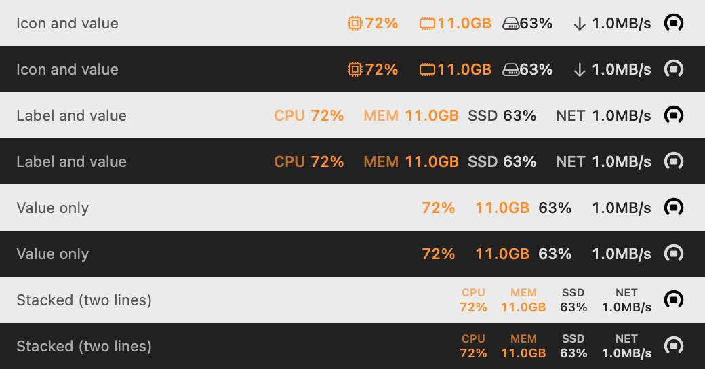

- Show any of **CPU**, **memory**, **disk** and **network download** next to the icon, in the order you choose.
- Four styles: **icon and value**, **label and value**, **value only**, **stacked** (two lines).
- Each stat has a **fixed width**, so the menu bar doesn't jump around as numbers change.
- **Highlight high usage** (on by default) turns a stat orange above 65 % and red above 85 %.
- A small cup appears next to the icon while **Stay Awake** is on, and a keyboard while **Keyboard Cleaning** is on.
- VoiceOver reads all values, e.g. "tully: CPU 12 percent, memory 8.1 gigabytes".

Settings → **Menu Bar** has a live preview on light and dark menu bars.

---

## System monitor

| Popover | System Monitor window |
| :---: | :---: |
|  | 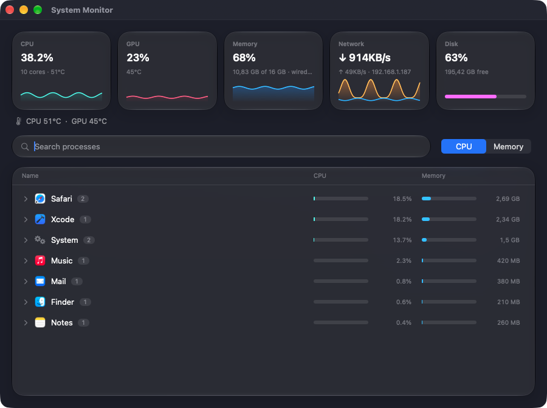 |

**Popover (System tab)**
- **CPU · Memory · Disk** rings. The level shows as both colour and text ("High", "Critical").
- Click the CPU or Memory ring for the full monitor, or the Disk ring for the Disk tab.
- Network download/upload with a one-minute chart (upload is dashed), plus your local IP.
- **Top memory** apps, with each app's helper processes grouped under it, and a quit button.

**System Monitor window** (from the rings, *All Processes*, or the right-click menu)
- History cards for CPU, GPU, memory (with wired and compressed), network and disk.
- CPU/GPU temperature and fan speeds where the Mac exposes them.
- Every process grouped under its app.
  - Search with **⌘F**.
  - Sort by CPU or memory.
  - Keyboard navigation: **↑↓** move, **→ ←** expand and collapse, **↩** opens details.
- The details sheet offers **Reveal in Finder**, **Quit** and **Force Quit**. tully refuses to quit itself or launchd, and explains failures (e.g. "permission denied").
- Sampling interval: 1, 2, 5 or 10 s. Process and sensor sampling only runs while the popover or this window is open.

---

## Disk and Disk Clean

| Disk tab | Disk Clean window |
| :---: | :---: |
|  | 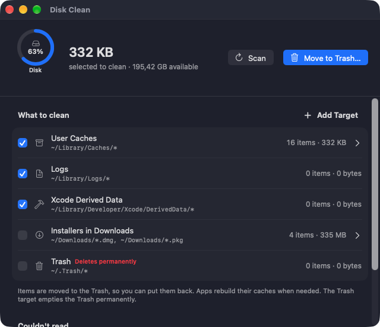 |

- The **Disk tab** shows a donut of the largest folders in your home folder, scanned on demand.
- Clicking the donut, a folder, or **Clean Up…** opens **Disk Clean**. Right-click a folder to show it in Finder.
- **Disk Clean**:
  1. Press **Scan**.
  2. Each target shows its item count and size: user caches, logs, Xcode DerivedData, installers in Downloads, and the Trash.
  3. Tick the targets you want, and expand a target to untick single items.
  4. Press **Move to Trash…** and review the summary before confirming.
- Items are **moved to the Trash**, so you can put them back. Only the Trash target deletes permanently, and it's labelled that way.
- **Custom targets** accept `~` and `*` (e.g. `~/Downloads/*.tmp`).
  - System folders are always blocked.
  - Paths inside `/Users`, `/Library`, `/Applications` and `/Volumes` must be at least 4 levels deep.
  - Every path is re-checked (symlinks resolved) right before it's moved.
- Folders tully can't read are listed, with a link to grant **Full Disk Access**.

---

## Window manager

### Zone shortcuts

Record a shortcut for any of 14 zones: halves (left, right, top, bottom), thirds, two-thirds, fullscreen and the four quarters.

- The recorder asks for ⌘, ⌃ or ⌥, so a shortcut never blocks typing. It warns when a combination is already taken and lets you replace it.
- Windows land on the screen that holds most of the window, which matters with several monitors.

### Window Ring (⌃⌥)


- **Hold ⌃⌥** (no other key) to open the ring at the cursor:
  - Move the mouse toward a zone: 8 directions for halves and quarters.
  - Push further out for thirds, fullscreen (up) or the center third (down).
  - A translucent **preview** shows exactly where the window will land, on the screen under the cursor, so you can fling windows to another display.
  - **Release ⌃⌥** to snap. Release in the middle, or press **Esc**, to cancel.
- The ring has **no keyboard shortcuts of its own**: ⌃⌥ with any other key passes straight through to the app in front. To move windows from the keyboard, record your own zone shortcuts (above).
- **The trigger can be remapped**: Settings → Window Ring → Trigger, then hold the new modifiers and release. You can also turn the ring off, change its size, and toggle the preview and trackpad haptics.
- The ring ignores the trigger while a mouse button is held, so it never fights the File Converter's drag wheels.

### Tiling suggestions


After a window snaps to a side, by shortcut or ring, tully lists your other windows on that screen to fill the space that's left.

- Click one, or use **↑↓** and **↩**.
- **Esc** or a click elsewhere dismisses it, and so does waiting (the delay is configurable).
- Turn it off in Settings → Window Manager.

---

## Window switcher

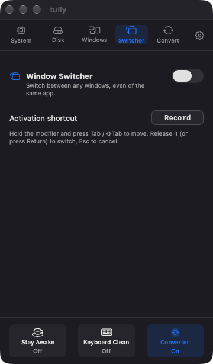

A keyboard window switcher that also switches between windows of the same app.

1. Set an activation shortcut (e.g. **⌥Space**) and enable the switcher.
2. Press the shortcut. Every window shows as a card, with live thumbnails if Screen Recording is granted (app icons otherwise).
3. Keep holding the modifier and press **Tab** / **⇧Tab** to move. The selected card has a checkmark.
4. Release the modifier, or press **↩**, to switch. **Esc** cancels.

---

## File Converter

**On by default** (switch it off in the popover or in Settings → File Converter). Start dragging a file and tap a modifier key; a wheel opens under the cursor:

| Tap mid-drag | Wheel | What's on it |
| :---: | --- | --- |
| ⇧ Shift | **Convert** | Every format the file can become: 355 conversion pairs across images, video, audio, PDF, documents, EPUB, slides, spreadsheets, subtitles and archives |
| ⌘ Command | **Tools** | 28 tools filtered to the file: compress (by % or target size), resize, rotate, flip, crop, adjust, annotate, redact, metadata, QR reading, make PDF, collage, trim, speed, split, join, normalize, bleep, channels, video crop and snapshot, PDF merge, split, reorganize and rotate, zip |
| ⌃ Control | **Actions** | AirDrop, Float (an always-on-top shelf), Copy, Move (recent folders), Copy Path, Terminal. Folders also get **Open folder in Terminal** and **Open folder in iTerm2**; code files get **Open in VS Code** (when those apps are installed). These "open in" entries are on the ⌘ Tools wheel too |

| Convert | Tools | Actions |
| :---: | :---: | :---: |
|  | 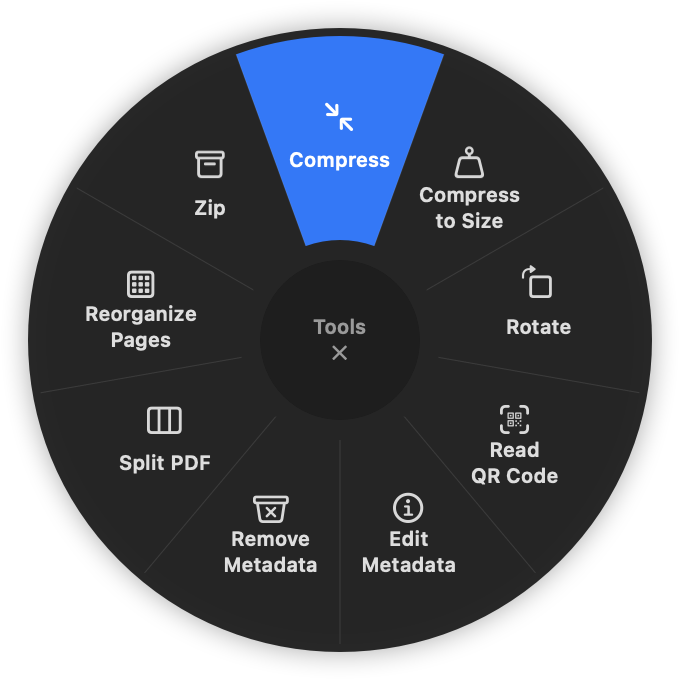 | 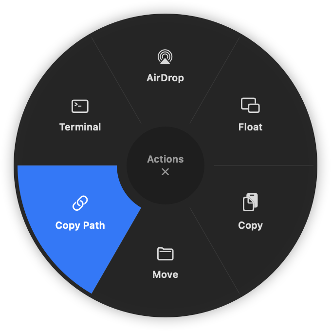 |

| Actions on a folder | Actions on a code file |
| :---: | :---: |
| 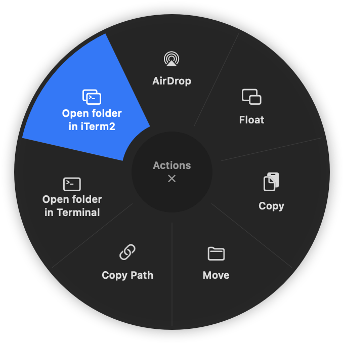 | 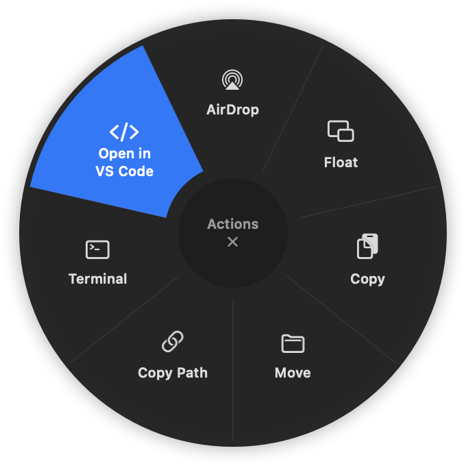 |

- Drop on a segment. The result appears next to the original (`Sunset.webp`, then `Sunset 2.webp`), or in a folder you choose.
- Drop on the center, or press **Esc**, to cancel.
- Inside a wheel, **arrow keys** move and **↩** picks. **↩** with nothing highlighted, or the **More…** segment, opens the full list.
- Several files at once: the wheel only offers targets they all share.
- A small card near the cursor shows progress and the result (click it to reveal the file), or a clear error such as "ffmpeg is required… brew install ffmpeg".
- **Without dragging**:
  - Use the **Convert** tab's drop zone, or *Convert Files… / File Tools… / File Actions…* in the right-click menu.
  - These show the same options as a list, which is also the accessible path for VoiceOver users.
  - The right-click menu also has *Recent Conversions*.
- Editors open for tools that need them: the photo editor (crop, adjust, annotate, redact), the PDF page organizer, and parameter forms.

| Photo editor | PDF pages | Tool form | Result card |
| :---: | :---: | :---: | :---: |
| 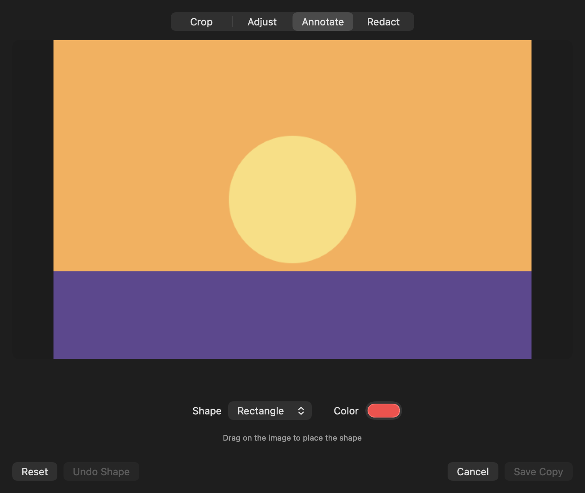 | 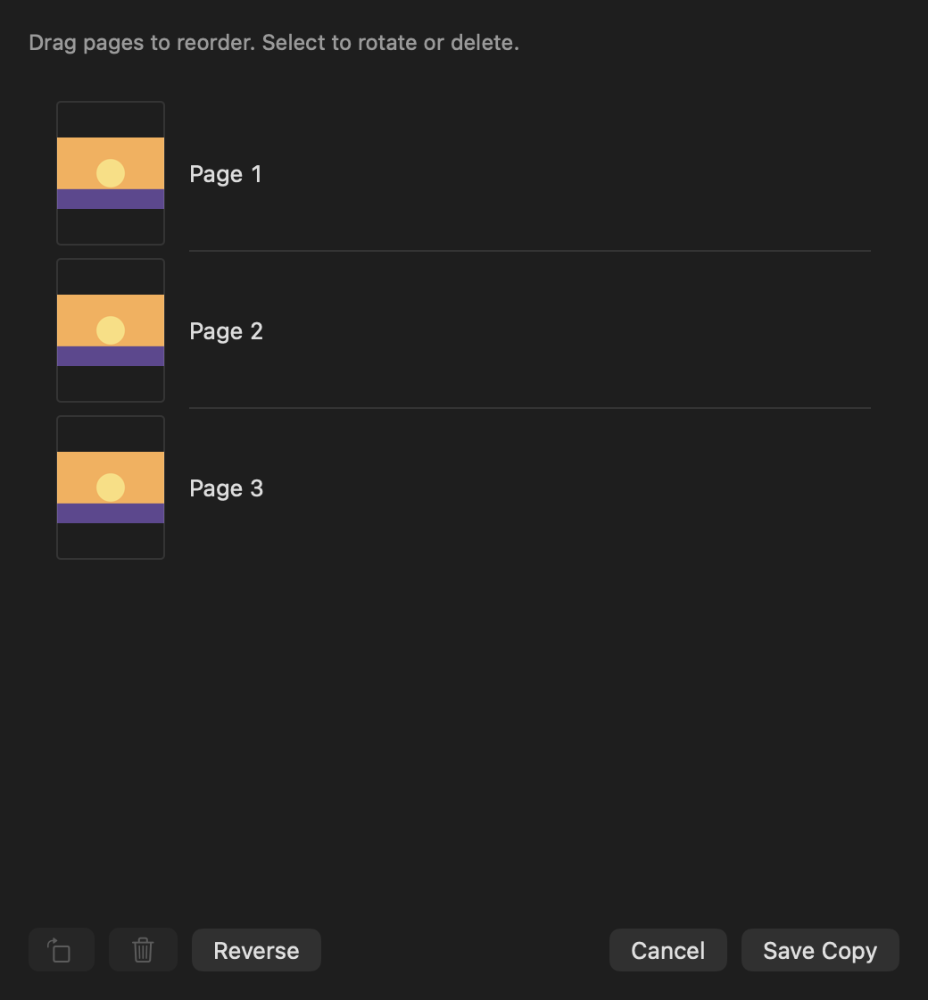 | 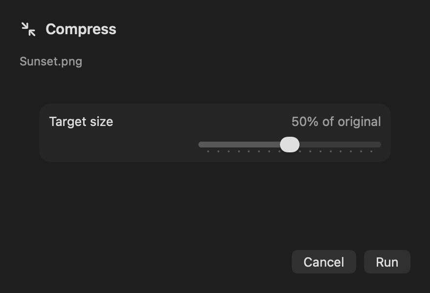 |  |

The wheels need **no permissions**. Video and audio need **ffmpeg** and WebP output needs **cwebp** (`brew install ffmpeg webp`); Settings shows whether they're installed and offers to copy the command. Pages, Keynote and Numbers formats use those apps when they're installed. Remap the wheel keys in Settings → File Converter.

---

## Stay Awake and Keyboard Cleaning

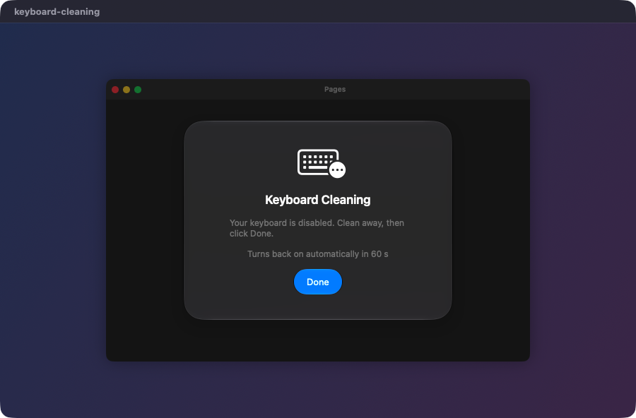

- **Stay Awake** keeps the Mac awake: Mac and display, or Mac only.
  - It can run until turned off, or for 15 min, 1 h or 2 h.
  - It always turns off when tully quits, so a forgotten setting never drains the battery.
- **Keyboard Cleaning** ignores every key, including media keys, while you wipe the keyboard.
  - Click **Done** to finish.
  - For safety it turns itself off after 1 minute by default (30 s to 5 min), with a countdown on screen.

Both are quick toggles in the popover and live in Settings → Power & Keyboard.

---

## Settings

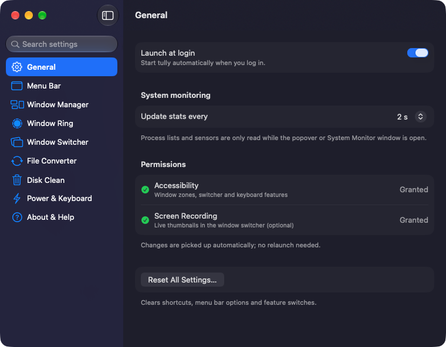

A regular window (⌘,) with a searchable sidebar:

| Pane | What's there |
| --- | --- |
| **General** | Launch at login, how often stats update, live permission status (no relaunch needed), reset everything |
| **Menu Bar** | Which stats, their order (drag), style, high-usage highlight, live preview |
| **Window Manager** | Zone shortcuts, tiling suggestions on/off and how long they stay |
| **Window Ring** | Trigger (default ⌃⌥, remappable), ring on/off, size, preview, haptics, direction map |
| **Window Switcher** | Enable, shortcut, permissions |
| **File Converter** | On/off, wheel keys, where results go, reveal in Finder, ffmpeg/cwebp status, recents |
| **Disk Clean** | Summary, safety rules, Full Disk Access status |
| **Power & Keyboard** | Stay Awake mode and duration, Keyboard Cleaning auto-exit |
| **About & Help** | Version, links, keyboard cheat-sheet |

---

## Permissions

| Permission | Needed for | Without it |
| --- | --- | --- |
| **Accessibility** | Zone shortcuts, Window Ring, tiling suggestions, window switcher, Keyboard Cleaning | Those features stay off; everything else works |
| **Screen Recording** | Live thumbnails in the switcher | App icons are shown instead |
| **Full Disk Access** *(optional)* | Disk Clean reading protected folders such as the Trash | Those folders are listed as unreadable |
| **Automation** *(asked on first use)* | Converting Pages, Keynote and Numbers files | Those formats are unavailable |

Grant them in System Settings → Privacy & Security. tully notices the change by itself; there's no need to relaunch.

---

## Requirements

- macOS 26 (Tahoe) or later
- Xcode 26 or later to build
- Optional for the File Converter: `brew install ffmpeg webp`

---

## Build and run

```bash
git clone https://github.com/simone98dm/tully.git
cd tully
./scripts/build.sh          # Release build → dist/tully.app
open dist/tully.app
```

Or open `tully.xcodeproj` in Xcode and press **⌘R**. The File Converter engine is a local Swift package (`Packages/KumquatCore`) that Xcode resolves automatically.

First launch:
1. Look for the ring icon in the menu bar.
2. Grant **Accessibility** when you want the window features (General in Settings shows what's missing).
3. The app is not notarized: right-click → **Open** the first time if Gatekeeper complains.

---

## Testing

```bash
./scripts/test.sh            # unit + UI + KumquatCore package tests, with coverage
./scripts/test.sh unit       # or: ui, packages
./scripts/perf.sh            # idle CPU and memory in three states (throwaway settings)
./scripts/e2e/run.sh         # File Converter end-to-end: real drags (moves the mouse; needs Terminal Accessibility)
./scripts/screenshots.sh     # regenerates screenshot/ with sample data (needs Terminal Screen Recording)
./scripts/export-icons.sh    # regenerates the app and menu bar icons from design/icon/
```

### Releasing

```bash
./scripts/release.sh minor --notes-file notes.md   # or patch / major; omit --notes-file to auto-generate notes
```

The script bumps the version in the project, builds **once** into `dist/tully.app`, checks that the built app reports the new version, zips that same app, commits, creates an annotated tag `vX.Y.Z`, pushes, and publishes the GitHub release. A GitHub Action (`.github/workflows/tag-version.yml`) also fails any pushed tag whose name doesn't match the app version, and `./scripts/version.sh` prints or checks the version by hand.

- **Unit tests** (`tullyTests`, Swift Testing) cover zone geometry, multi-monitor screen choice, shortcut normalization, the shared event tap, the switcher and ring state machines, menu bar formatting, sampler math, process grouping, Disk Clean policy and Trash behaviour, Stay Awake assertions, Keyboard Cleaning, tiling suggestions and the converter switch.
- **UI tests** (`tullyUITests`) drive the popover, the Settings window, Disk Clean and System Monitor, and check that every control has an accessibility label.
- **KumquatCore** runs the full conversion matrix.

Launch flags used by tests and tools:

| Flag | Effect |
| --- | --- |
| `--ui-testing` | Throwaway settings, no event taps or global monitors |
| `--isolated-defaults` | Full app with throwaway settings |
| `--demo-data` | Sample numbers instead of live sampling |
| `--open-popover-window[=Tab]` | Popover content in a window |
| `--open-settings=<pane>` | Settings window on a pane |
| `--open-system-monitor` | System Monitor window |
| `--open-disk-clean` | Disk Clean window |
| `--open-about` | About window |

---

## Project layout

```
tully/
  AppDelegate.swift, ContentView.swift      menu bar item, popover tabs, windows
  Shared/                                   event tap, permissions, geometry, formatters, catalog, UI components
  Modules/
    SystemMonitor/   sampler, sensors, process groups, popover + window views
    StatusBar/       menu bar formatter and renderer
    DiskUtility/     Disk tab
    DiskClean/       path policy, service, window
    WindowManager/   zones, shortcuts, tiling suggestions, free-space math
    WindowRing/      ring logic, key handling, ring and preview
    TabSwitch/       window switcher
    FileConverter/   drag wheels, jobs, editors, settings
    Controls/        Stay Awake, Keyboard Cleaning
    Settings/        Settings window panes
Packages/KumquatCore/  conversion engine (formats, tools, wheel logic) + tests
tullyTests/, tullyUITests/
design/icon/         icon source (IconKit.swift, SVG masters, direction sheet)
scripts/             build, test, perf, e2e, screenshots, icons
```

---

## Privacy, uninstall and credits

- **Privacy:** no network calls and no analytics. Conversions, scans and cleanups happen on your Mac.
- **Uninstall:** quit tully, delete the app, then `defaults delete com.simone98dm.tully`.
- **Credits:** the ring concept is inspired by [Loop](https://github.com/MrKai77/Loop), the tiling suggestions and Disk Clean rules by [One Menu](https://coffeebreak.software/one-menu/), and the File Converter by [Tangerine](https://apps.apple.com/app/id6813034065). No code was copied from Loop (GPL); the ring is an independent implementation.
